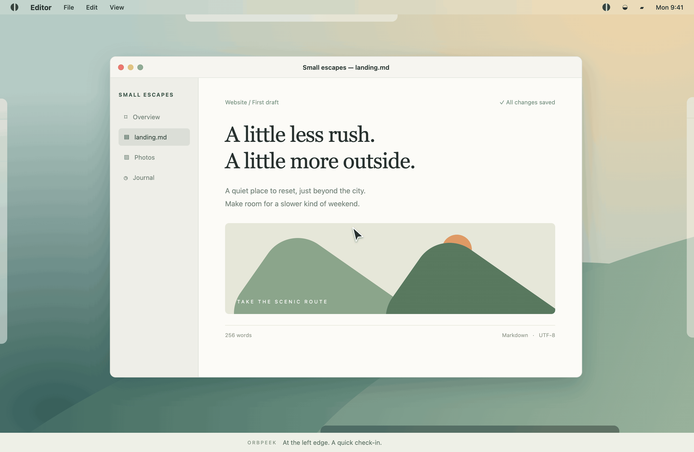

<p align="right"><a href="README.md">中</a> / <b>EN</b></p>

<p align="center"></p>
<h1 align="center">OrbPeek</h1>
<p align="center">Windows within reach. Room to focus.</p>
<p align="center"><a href="#install">Install</a> · <a href="https://zhiyozhao.github.io/OrbPeek/en/">Website</a> · macOS 14+ · Free and open source</p>

<p align="center"></p>

A different way to manage macOS windows. Park what you don't need right now at a screen edge, leaving just a narrow preview. Your chat, notes and music stay close, with the center free for your work.

- Use all four edges. Give useful windows a place without keeping them on your desk.
- Hover when you need them. Check a message or look something up in the actual window, ready to use.
- Make room on every display. Keep useful windows at the edges of each screen.

## Install

Requires macOS 14 or later. Choose an installation method, then set up permissions.

### Homebrew (recommended)

1. Open Terminal and run:

   ```sh
   brew install --cask zhiyozhao/tap/orbpeek
   ```

2. Open OrbPeek from Applications or Spotlight. Its icon appears in the menu bar, with no Dock icon. Homebrew installations open directly, without developer verification steps.
3. Complete “First launch: permissions” below.

To update: `brew upgrade --cask orbpeek`, then reopen OrbPeek.

### Manual DMG installation

1. Download the latest `OrbPeek-version.dmg` from [Releases](https://github.com/zhiyozhao/OrbPeek/releases/latest).
2. Open the DMG, drag OrbPeek to Applications, then open it from there.
3. If macOS can't verify the developer, allow it to open. OrbPeek is not yet notarized by Apple. After trying to open it once, go to System Settings → Privacy & Security, find the OrbPeek notice near the bottom, click Open Anyway, authenticate and confirm. On macOS 14 you can also Control-click OrbPeek in Finder, choose Open, then confirm again.
4. Set up permissions below.

### First launch: permissions

Both installation methods use these permissions, for different purposes:

| Permission | Purpose | Without it |
|---|---|---|
| Accessibility (required) | Move and reveal windows | Docking and hover won't work |
| Screen Recording (optional) | Generate window preview images | Docking and hover still work, with dark placeholder strips |

1. **Accessibility:** On first launch, click Open Settings. Go to System Settings → Privacy & Security → Accessibility and enable OrbPeek. If it isn't listed, click “+” to add it from Applications. It works immediately, with no restart.
2. **Screen Recording:** Click the OrbPeek menu bar icon → Screen Recording — Click to Grant. Read the explanation, click Continue, then allow access when prompted. You can also enable it later under System Settings → Privacy & Security → Screen Recording, called “Screen & System Audio Recording” on some versions. If macOS asks you to quit and reopen, follow that prompt.

Screen Recording is only used for preview images, held in memory. No video or audio is recorded.

## Start using OrbPeek

1. Focus a window and press <kbd>⌃⌘</kbd> (Control + Command) + <kbd>←</kbd> / <kbd>→</kbd> / <kbd>↑</kbd> / <kbd>↓</kbd> to park it at that edge.
2. Hover over its preview strip to reveal the window. Move away to hide it.
3. Open the menu bar icon → Settings… to change the four shortcuts, strip width and opacity, or enable launch at login.

To keep a window on your desktop, reveal it and drag it away from the edge, or click its name in the menu bar list.

## Questions

**Can't find a window?** Reopen OrbPeek. It will try to bring back windows left off screen after an unexpected exit. Quitting normally also puts docked windows back on the desktop.

**Do I need an account or connection?** No. OrbPeek stays offline, with no account, analytics or uploads.

**How do I uninstall?** Quit OrbPeek first, then run `brew uninstall --cask --zap orbpeek`. For a manual installation, quit and move OrbPeek from Applications to the Trash. To remove settings and runtime data, delete `~/Library/Preferences/com.orbpeek.OrbPeek.plist`, `~/Library/Application Support/OrbPeek/`, `~/Library/Logs/orbpeek.log`, and `~/.config/orbpeek/` if left by an older version.

## License

[MIT](LICENSE)
