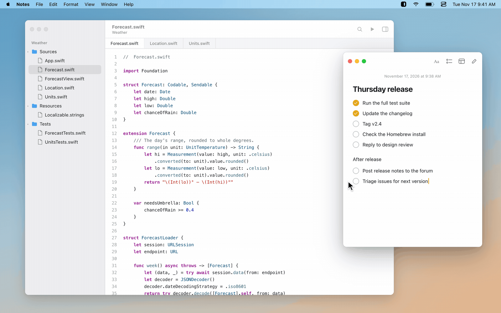

<p align="center"></p>

<h1 align="center">OrbPeek</h1>

<p align="center"><a href="README.md">中文</a> · English · <a href="https://zhiyozhao.github.io/OrbPeek/en/">Website</a></p>

Dock a window to the screen edge and keep only a thin preview strip. Point at the strip and the window appears against that edge; move away and it goes back. Made for windows you glance at all day but don't want taking up the screen: notes, chat, a terminal.

<picture>
  <source media="(prefers-color-scheme: dark)" srcset="docs/assets/demo-en-dark.gif">
  
</picture>

## Install

```sh
brew install --cask zhiyozhao/tap/orbpeek
```

Requires macOS 14 or later. On first launch OrbPeek asks for Accessibility permission and works as soon as you grant it.

Update with `brew upgrade --cask orbpeek`. Without Homebrew, download the DMG from [Releases](https://github.com/zhiyozhao/OrbPeek/releases/latest) and drag OrbPeek into Applications. The app is not notarized by Apple, so macOS blocks the first launch: on macOS 15, double-click it once, then click "Open Anyway" at the bottom of System Settings → Privacy & Security; on macOS 14 you can right-click it in Finder and choose Open. Installing with Homebrew skips this step.

## How it differs

- **Minimize**: the window goes to the Dock, and you have to find it and click it. With OrbPeek the window stays at the edge you put it on. Point there and it comes out; move away and it goes back.
- **Split View**: two windows share the screen, so your main window is always narrower. OrbPeek leaves your main window's size alone. The other window covers it only while you look at it.
- **Stage Manager**: rearranges all your windows and keeps thumbnails along one side. OrbPeek handles only the window you pressed the shortcut on. Your layout stays the same.

## Usage

| Action | How |
|---|---|
| Dock | <kbd>⌃</kbd><kbd>⇧</kbd> plus <kbd>←</kbd> / <kbd>→</kbd> / <kbd>↑</kbd> / <kbd>↓</kbd> docks the front window to the left, right, top or bottom edge. Press another direction on a docked window to move it to that edge. |
| See it | Rest the pointer on the strip for 0.15 s. Fling the pointer at the screen edge and the window appears at once. |
| Hide it again | Move the pointer out after using the window, or switch to another app. |
| Move or resize | While the window is out, drag it along the edge and the strip follows to the new spot. Resizing keeps it docked. |
| Undock | Click the window's name in the menu bar icon and it goes back to where it was. Or, while it is out, drag it more than 40 px toward the middle of the screen and it stays where you drop it. Minimizing the window or hiding its app (<kbd>⌘</kbd><kbd>H</kbd>) also undocks it. |

You can change the shortcuts in Settings. Quitting OrbPeek puts every docked window back where it was. If OrbPeek quits unexpectedly and leaves windows off screen, open OrbPeek again and it brings them back on screen.

## The preview strip

The strip is a picture of the window's edge taken when you dock it: dock it right and you see its left edge, dock it to the top and you see its bottom edge. It lines up with where the window was. It does not update live; it is taken again when the window goes back while its app is in front. Clicks pass through the strip.

## Settings

Choose Settings… from the menu bar icon.

- Launch at login
- A shortcut for each direction
- Preview strip width: 5–50 px, 15 px by default
- Preview strip opacity: 20%–100%, 50% by default

## Permissions

The menu bar icon shows both permissions. Click one that is missing to grant it.

- **Accessibility (required)**: to read and move windows. No restart needed after granting it.
- **Screen Recording (optional)**: only for the preview strip. OrbPeek captures the window's area once each time you dock it and keeps the picture in memory. No video, no audio. Without it docking still works and the strip is a dark translucent placeholder.

## What it doesn't do

- No automatic docking: only the shortcut docks a window. Dragging it to the edge does not.
- No live preview: the strip is a still picture. OrbPeek never keeps recording the screen.
- No window layout: no tiling, no splitting. It leaves your other windows alone.
- No network: no account, no analytics, nothing uploaded.

## Data and uninstalling

OrbPeek writes only these files on your Mac:

- Settings: `~/Library/Preferences/com.orbpeek.OrbPeek.plist`
- A record of docked windows, used to bring them back after an unexpected quit: `~/Library/Application Support/OrbPeek/`
- Log: `~/Library/Logs/orbpeek.log`, opened by Open Log… in the menu

`brew uninstall --cask --zap orbpeek` removes these files too. If you drag the app to the Trash instead, they stay behind and you need to delete them yourself.

## License

[MIT](LICENSE)
