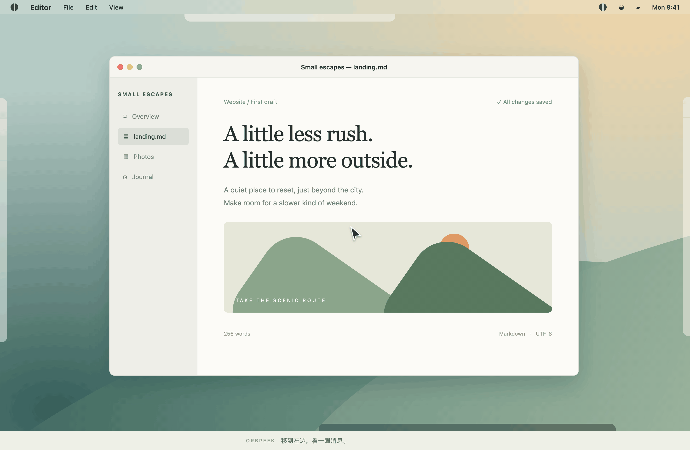

<p align="right"><b>中</b> / <a href="README.en.md">EN</a></p>

<p align="center"></p>
<h1 align="center">OrbPeek</h1>
<p align="center">窗口在手边，桌面有空间。</p>
<p align="center"><a href="#安装">安装</a> · <a href="https://zhiyozhao.github.io/OrbPeek/">官网</a> · macOS 14+ · 免费开源</p>

<p align="center"></p>

换一种方式管理 macOS 窗口。把暂时不用的窗口贴在屏幕边上，只留一条窄窄的预览。聊天、笔记和音乐都还在，中央留给正在做的事。

- 四条边都能贴。常用窗口各有位置，不必一直占着桌面。
- 需要时，鼠标移过去。看一眼消息，查一下资料，出来的就是能直接用的窗口。
- 支持多显示器。每块屏幕都能在边上留好自己的常用窗口。

锁屏或睡眠后，原屏幕及时回来会保持贴边；屏幕断开或停靠边被新屏挡住时，窗口会取消贴边并回到可见位置，屏幕接回后不会自动贴回。

## 安装

需要 macOS 14 或更高版本。选一种安装方式，再设置权限。

### Homebrew（推荐）

1. 打开「终端」，运行：

   ```sh
   brew install --cask zhiyozhao/tap/orbpeek
   ```

2. 在「应用程序」或聚焦搜索里打开 OrbPeek。它的图标在菜单栏，没有 Dock 图标。Homebrew 安装后可直接打开，不需要处理开发者验证。
3. 完成下面的「第一次打开：权限」。

以后更新：`brew upgrade --cask orbpeek`，更新后重新打开 OrbPeek。

### 手动安装 DMG

1. 到 [Releases](https://github.com/zhiyozhao/OrbPeek/releases/latest) 下载最新的 `OrbPeek-版本号.dmg`。
2. 打开 DMG，把 OrbPeek 拖进「应用程序」，再从那里打开。
3. 若提示「无法验证开发者」，先允许打开：OrbPeek 尚未经过 Apple 公证。尝试打开一次后，进入「系统设置 → 隐私与安全性」，在页面底部找到 OrbPeek 的提示，点「仍要打开」，按系统提示验证并确认。macOS 14 也可以在「访达」中按住 Control 点 OrbPeek，选「打开」，再确认一次。
4. 完成下面的权限设置。

### 第一次打开：权限

两种安装方式都需要设置。两项权限用途不同：

| 权限 | 用来做什么 | 不开启会怎样 |
|---|---|---|
| 辅助功能（必需） | 移动和呼出窗口 | 无法使用贴边和呼出 |
| 屏幕录制（可选） | 为预览条生成窗口画面 | 仍能贴边和呼出，预览条显示为深色占位条 |

1. **辅助功能**：首次打开会提示，点「打开设置」，进入「系统设置 → 隐私与安全性 → 辅助功能」，开启 OrbPeek。如果列表中没有，点「+」添加「应用程序」中的 OrbPeek。授权后即可使用，不需要重启。
2. **屏幕录制**：点菜单栏 OrbPeek 图标，选「屏幕录制 — 点击授权」，阅读说明后点「继续」，按系统提示允许。也可以稍后在「系统设置 → 隐私与安全性 → 屏幕录制」中开启；部分系统显示为「屏幕与系统音频录制」。若系统要求退出并重新打开，按提示操作。

屏幕录制权限只用于预览图，不录像、不录音；图像只留在内存里。

## 开始使用

1. 选中一个窗口，按 <kbd>⌃⌘</kbd>（Control + Command）+ <kbd>←</kbd> / <kbd>→</kbd> / <kbd>↑</kbd> / <kbd>↓</kbd>，把它贴到对应的边。
2. 鼠标移到预览条上，窗口就出现；移开，窗口就收起。
3. 点菜单栏图标 →「设置…」，可以修改四个方向的快捷键、预览条宽度和不透明度，也可以设置开机自启动。

想把窗口留在桌面上，呼出后往屏幕中间拖开，或在菜单栏列表里点它的名字即可。

## 常见问题

**窗口找不到了？** 在 OrbPeek 菜单中点「找回所有窗口」，把贴边窗口和因换屏取消贴边的窗口放回桌面。意外退出后重新打开也会尝试恢复遗留窗口；正常退出后两分钟内重开，可恢复未被移动的贴边窗口。

**需要账号或网络吗？** 不需要。没有账号、统计或上传。

**怎么卸载？** 先退出 OrbPeek，再运行 `brew uninstall --cask --zap orbpeek`；手动安装的版本先退出，再把「应用程序」中的 OrbPeek 移到废纸篓。如需清理设置和运行记录，删除 `~/Library/Preferences/com.orbpeek.OrbPeek.plist`、`~/Library/Application Support/OrbPeek/`、`~/Library/Logs/orbpeek.log`，以及旧版可能留下的 `~/.config/orbpeek/`。

## 许可

[MIT](LICENSE)
