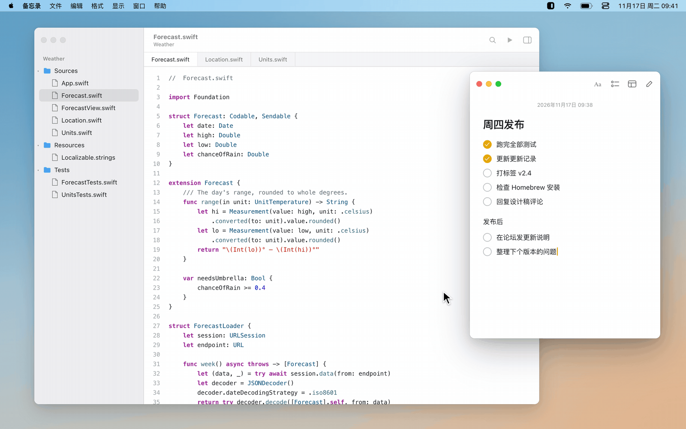

<p align="center"></p>

<h1 align="center">OrbPeek</h1>

<p align="center">中文 · <a href="README.en.md">English</a> · <a href="https://zhiyozhao.github.io/OrbPeek/">官网</a></p>

把窗口贴到屏幕边上，只留一条窄窄的预览。鼠标碰到预览条，窗口贴着这条边出现；移开，它就收回去。适合笔记、聊天、终端这类要时不时看一眼、又不想一直占着屏幕的窗口。

<picture>
  <source media="(prefers-color-scheme: dark)" srcset="docs/assets/demo-zh-dark.gif">
  
</picture>

## 安装

```sh
brew install --cask zhiyozhao/tap/orbpeek
```

需要 macOS 14 或更高版本。第一次打开会请求「辅助功能」权限，授权后马上可用。

更新用 `brew upgrade --cask orbpeek`。不用 Homebrew 的话，到 [Releases](https://github.com/zhiyozhao/OrbPeek/releases/latest) 下载 DMG，把 OrbPeek 拖进「应用程序」。这个 app 没有经过 Apple 公证，第一次打开会被拦下：macOS 15 上先双击一次，再到「系统设置 → 隐私与安全性」页面底部点「仍要打开」；macOS 14 上可以在 Finder 里右键选「打开」。用 Homebrew 安装不会遇到这一步。

## 和其他办法的区别

- **最小化**：窗口进了 Dock，要回去找它、点它。OrbPeek 的窗口留在你放它的那条边上，鼠标过去就出来，离开就收回。
- **分屏**：两个窗口平分屏幕，主窗口一直变窄。OrbPeek 不改主窗口的大小，另一个窗口只在你看它时盖在上面。
- **台前调度**：重排所有窗口，屏幕一侧常驻缩略图。OrbPeek 只管你按了快捷键的那个窗口，桌面布局不变。

## 用法

| 操作 | 方法 |
|---|---|
| 贴边 | <kbd>⌃</kbd><kbd>⇧</kbd> 加 <kbd>←</kbd> / <kbd>→</kbd> / <kbd>↑</kbd> / <kbd>↓</kbd>，把当前窗口贴到左、右、上、下边。对已贴边的窗口按另一个方向，就换一条边。 |
| 查看 | 鼠标在预览条上停 0.15 秒。快速把鼠标甩向屏幕边，窗口会立刻出现。 |
| 收回 | 在窗口里停留过再移开，或者切到别的 app。 |
| 挪位置、改大小 | 窗口出现时沿着这条边拖动，松手后预览条跟到新位置。改窗口大小不会取消贴边。 |
| 取消贴边 | 在菜单栏图标里点这个窗口的名字，它回到贴边前的位置。也可以在它出现时往屏幕中间拖开 40 px 以上，它会留在你松手的地方。最小化这个窗口或隐藏它的 app（<kbd>⌘</kbd><kbd>H</kbd>）也会取消贴边。 |

快捷键可以在设置里改。退出 OrbPeek 时，所有贴边的窗口都会回到原来的位置。如果 OrbPeek 意外退出、窗口留在了屏幕外，重新打开 OrbPeek 就会把它们放回屏幕内。

## 预览条

预览条是贴边那一刻截下的窗口边缘：贴到右边就显示窗口的左边缘，贴到上边就显示窗口的下边缘，位置和窗口原来的位置对齐。它不会实时刷新；窗口收回时如果它的 app 在前台，会重新截一次。预览条不挡鼠标点击。

## 设置

在菜单栏图标里选「设置…」。

- 开机自启动
- 四个方向的快捷键
- 预览条宽度：5–50 px，默认 15 px
- 预览条不透明度：20%–100%，默认 50%

## 权限

菜单栏图标里能看到两项权限的状态，点没有授权的那一项就能去授权。

- **辅助功能（必需）**：读取和移动窗口。授权后不需要重启 OrbPeek。
- **屏幕录制（可选）**：只用来截预览条。每次贴边时截一次窗口所在的区域，图片只留在内存里，不录像，不录音。不授权也能贴边，预览条会变成一条半透明的深色占位条。

## 刻意不做的事

- 不自动贴边：只有按快捷键才会贴边，把窗口拖到屏幕边上不会。
- 不实时预览：预览条是一张截图，OrbPeek 不会持续录屏。
- 不管窗口布局：不平铺、不分屏，其他窗口它不碰。
- 不联网：没有账号、统计或自动上传。

## 数据和卸载

OrbPeek 只在本机写这几样东西：

- 设置：`~/Library/Preferences/com.orbpeek.OrbPeek.plist`
- 当前贴边窗口的记录，用于意外退出后把窗口找回来：`~/Library/Application Support/OrbPeek/`
- 日志：`~/Library/Logs/orbpeek.log`，菜单里的「打开日志…」会打开它

`brew uninstall --cask --zap orbpeek` 会连同这些文件一起删除。直接把 app 拖进废纸篓的话，它们会留下来，需要手动删。

## 许可

[MIT](LICENSE)
