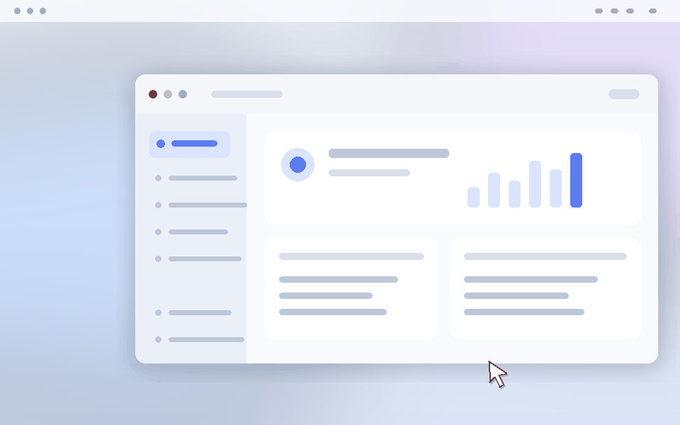

# OrbPeek

中文 | [English](README.en.md) · [官网](https://zhiyozhao.github.io/OrbPeek/)

用快捷键把窗口贴边到屏幕边缘，只留下一条预览条；鼠标碰到边缘，窗口就滑出来。

[](https://github.com/zhiyozhao/OrbPeek/releases/latest)


<picture>
  <source media="(prefers-color-scheme: dark)" srcset="docs/assets/demo-dark.gif">
  
</picture>

```bash
brew install --cask zhiyozhao/tap/orbpeek
```

不用 Homebrew 的话，到 [Releases](https://github.com/zhiyozhao/OrbPeek/releases/latest) 下载 DMG，把 OrbPeek 拖进“应用程序”。

## 亮点

- `Control + Shift + 方向键` 把当前窗口贴到对应边缘，上下左右都可以。
- 边缘留下窗口预览条，不用切换 app，鼠标一碰就能查看和操作。
- 鼠标离开后窗口自动收回；把窗口往屏幕内拖远，就取消贴边。
- 同一边可以放下多个贴边窗口，多块显示器可以分别贴边。
- 插拔显示器、锁屏或睡眠后，窗口会跟随当前的屏幕布局。
- 快捷键、预览条宽度和不透明度都可以调整，也能设为开机启动。
- 中文、英文界面跟随系统语言。

## 首次使用

1. 打开 OrbPeek，菜单栏会出现图标。
2. 按弹窗提示打开“系统设置 → 隐私与安全性 → 辅助功能”，打开 OrbPeek 的开关。授权后即可使用，不需要重启 OrbPeek。
3. 点击菜单栏图标，在“屏幕录制”一项中完成授权。

**为什么要“辅助功能”？** OrbPeek 需要读取并移动你贴边的窗口，在取消贴边或异常恢复时把窗口放回可见区域。没有这项权限，它无法替你移动窗口。这项权限不会用来记录你输入的文字。

**为什么还要“屏幕录制”？** 它只用于给贴边的窗口生成预览条，不会持续录像，也不会录音。不授权仍能贴边和滑出窗口，只是边缘会显示半透明占位条，看不到窗口画面。

两项权限都可以随时在“系统设置 → 隐私与安全性”里关闭。关闭辅助功能后，OrbPeek 不能再移动窗口；关闭屏幕录制后，不会再生成新的窗口预览条。

## 怎么用

- **贴边**：切换到要收的窗口，按 `Control + Shift + ← / → / ↑ / ↓`。
- **查看**：把鼠标移到边缘的预览条上，窗口会滑到最前面；鼠标离开后，窗口收回去。
- **取消贴边**：把滑出的窗口向屏幕内拖远，或者点击菜单栏图标，再点对应窗口的名称。
- **调整**：在菜单栏图标的“设置…”里修改四个快捷键、预览条宽度、不透明度和开机启动。

## 隐私

- 不持续录屏，不录音，不记录你输入的文字。
- 窗口预览条只保存在内存里；取消贴边后，对应的截图缓存会被删除。
- 没有联网功能，不上传窗口画面、窗口标题或设置。
- 偏好设置、快捷键和运行日志只保存在本机。为了在异常退出后找回窗口，OrbPeek 会暂存贴边窗口所属的 app、标题和位置等恢复信息；正常取消贴边或退出后会清除。

## 常见问题

**打开 DMG 里的 app 时，提示“无法验证开发者”？**
这个 app 没有经过 Apple 公证。macOS 15 上先双击打开一次，再到“系统设置 → 隐私与安全性”页面底部点“仍要打开”，输入密码确认；macOS 14 也可以在 Finder 中右键选择“打开”。Homebrew 安装会自动处理下载隔离，不会遇到这个提示。

**OrbPeek 意外退出后，窗口去哪了？**
正常退出时，OrbPeek 会先把所有贴边窗口放回来。意外退出或被强制结束后，下次启动会自动寻找仍然存在的屏外窗口，把它们放回最近显示器的可见区域，不会重新贴边。请保持辅助功能权限开启；如果所属 app 或窗口也已经关闭，就无法恢复。

**怎么卸载？**
执行 `brew uninstall --cask --zap orbpeek` 会同时清理日志、偏好设置、崩溃恢复数据和旧配置。直接把“应用程序”里的 OrbPeek 拖到废纸篓会留下 `~/Library/Logs/orbpeek.log`、`~/Library/Preferences/com.orbpeek.OrbPeek.plist`、`~/Library/Application Support/OrbPeek` 和 `~/.config/orbpeek`。

## 已知限制

如果系统的 ScreenCaptureKit 连续超时，OrbPeek 会重启系统录屏进程 `replayd` 来恢复预览条；这可能短暂影响其他 app 的屏幕共享或录制。只有连续 3 次超时才会触发，且重启后有 5 分钟冷却。

## 许可证

[MIT](LICENSE)

[更新记录](CHANGELOG.md) · [开发文档](docs/DEVELOPMENT.md)
